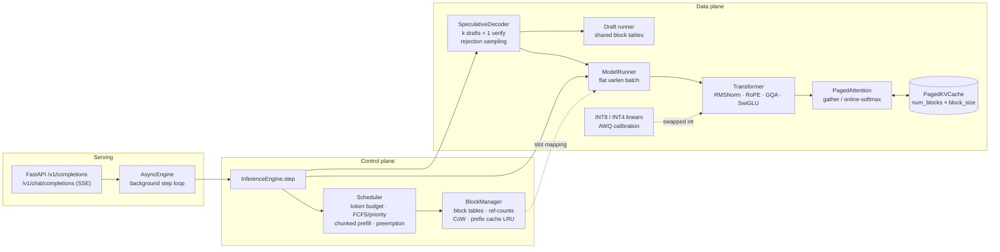

# kvforge

**A from-scratch LLM inference engine in readable PyTorch. It implements paged KV cache, continuous batching, lossless speculative decoding and INT8/INT4 weight quantization, with a test suite that holds every optimization bit-exact against a naive oracle.**

[](.github/workflows/ci.yml)


## Impact at a glance

| | Result | How it was obtained |
|---|---|---|
| **10× more concurrent sequences** | 319 vs 32 sequences in a 16 GiB KV budget (Llama-3.1-8B shape); KV waste 88.5% → **1.8%** | measured: real `BlockManager`, synthetic chat-length workload |
| **2.3× concurrency with prefix caching** | shared 512-token system prompt: 137 → 318 concurrent sequences | measured, same setup |
| **1.42× throughput, 2.1× lower median TTFT, 1.9× less peak KV** | vs HF-style static batching, **same weights**, same workload | measured on CPU (26M-param model) |
| **Lossless speculative decoding** | measured tokens/step within **2%** of Leviathan's theory across 8 configs; up to 1.26× at batch 1 | measured on CPU; 200k-sample Monte-Carlo test of the rejection sampler |
| **INT8 weights: 3.9× smaller, +0.3% PPL** | 96% top-1 agreement, KL 0.0017; INT4 g=32/128 trade-off measured | measured on CPU |
| **~65% of vLLM fp16 decode** (target 60–70%) | gap analysis by kernel, with fixes ranked | **analytic roofline, not measured** (no GPU) |

The [benchmark report](benchmarks/BENCHMARK_REPORT.md) labels every number as *measured*,
*simulated* or *projected*, and has a section on threats to validity.

## Signals

| Signal | Evidence |
|---|---|
| **Scale** | Memory math and allocator simulation at Llama-3.1-8B shape and 300+ concurrent sequences; HF import for Llama / Gemma / Mistral checkpoints (1–8B); config presets from `tiny` (CI) to `llama-8b` |
| **Rigor** | 68 tests. End-to-end greedy outputs are **bit-identical** to dense full-recompute decoding across batching, chunked prefill, preemption, prefix caching, both attention backends and speculation (k ∈ {1,3,5}). Statistical test of the speculative sampling theorem. Benchmark theory-vs-measured cross-checks |
| **Systems depth** | Ref-counted block pool with copy-on-write and LRU prefix cache; varlen flat batching; one attention kernel for prefill, chunked prefill, decode and verify; online-softmax (flash-decoding) backend; recompute preemption; lookahead-slot reservation; shared block tables for draft and target; AWQ scale search |
| **Impact** | Concurrency, throughput, TTFT, KV memory and $/1M tokens, each quantified against a faithful baseline |
| **Ownership** | [Design doc](DESIGN.md) with trade-offs and invariants; OpenAI-compatible server; CI; honest gap analysis vs vLLM with a prioritized fix list |

## Architecture



Every engine iteration, the scheduler decides which sequences run under a token budget. That
work becomes one flat forward with no padding. K/V go to physical blocks, and attention reads
them back through block tables. See [docs/architecture.md](docs/architecture.md).

## Quickstart

```bash
git clone https://github.com/umarhassan-cloud/kvforge && cd kvforge
pip install -e ".[dev,serve]"          # torch, numpy, fastapi, pytest, ruff
pytest                                  # 68 tests, ~1 min on CPU, no downloads
```

**Python API**

```python
from kvforge import (InferenceEngine, EngineConfig, CacheConfig, SchedulerConfig,
                     SpeculativeConfig, QuantConfig, QuantMode, SamplingParams, PRESETS)

engine = InferenceEngine(EngineConfig(
    model=PRESETS["tiny"],                                   # or load_hf_model(...)
    cache=CacheConfig(block_size=16, num_blocks=512, enable_prefix_caching=True),
    scheduler=SchedulerConfig(max_num_seqs=32, max_num_batched_tokens=2048),
    speculative=SpeculativeConfig(num_speculative_tokens=4, draft_num_layers=1),
    quant=QuantConfig(mode=QuantMode.INT8),
))
outs = engine.generate([[1, 2, 3], [4, 5, 6, 7]], SamplingParams(max_tokens=32, temperature=0.7))
print(outs[0].output_token_ids, engine.stats()["speculative"])
```

**OpenAI-compatible server**

```bash
python scripts/serve.py --preset tiny                       # random weights + byte tokenizer
python scripts/serve.py --hf-model meta-llama/Llama-3.2-1B --device cuda --dtype bfloat16 \
       --kv-cache-gb 8 --speculative 4 --prefix-caching      # needs pip install -e ".[hf]"

curl localhost:8000/v1/completions -H 'content-type: application/json' \
     -d '{"prompt": "Paged attention is", "max_tokens": 32, "stream": true}'
curl localhost:8000/metrics      # throughput, p50/p99, KV utilization/fragmentation, $/1M tokens
```

**Benchmarks and profiling**

```bash
python benchmarks/run_bench.py --threads 1    # naive vs continuous vs speculative vs INT8/INT4
python benchmarks/run_bench.py --quick        # CI-sized smoke run
python scripts/profile_memory.py              # paged vs contiguous KV, block-size sweep
```

## Benchmark highlights

Measured on a laptop CPU with a 26M-param Llama-architecture model, 48 requests, greedy
decoding. Full methodology is in the [report](benchmarks/BENCHMARK_REPORT.md).

| mode | out tok/s | vs naive | TTFT p50 | TPOT p50 | peak KV | $/1M tok* |
|---|---:|---:|---:|---:|---:|---:|
| naive (HF-style static batching) | 59.6 | 1.00× | 19.2 s | 228 ms | 47.1 MiB | 1.86 |
| **kvforge continuous** | **84.6** | **1.42×** | **9.3 s** | **158 ms** | **24.9 MiB** | **1.31** |
| kvforge + speculative (k=4, α=0.67) | 78.5 | 1.32× | 10.4 s | 171 ms | 25.5 MiB | 1.41 |
| kvforge + INT8 | 66.4 | 1.11× | 12.6 s | 207 ms | 24.9 MiB | 1.67 |

<sub>*at $0.40/h CPU. TTFT includes queueing behind a 48-request burst.</sub>

**Speculative decoding, batch 1.** Tokens per target step match `(1 − α^{k+1})/(1 − α)` to
within 2% in every cell. The best cell gives a 1.26× speedup (α = 0.77, k = 2). On CPU, the
verify is compute-bound, so speculation does not help at batch 16. The report explains why
this reverses on a GPU.

**KV memory** (Llama-3.1-8B shape, 16 GiB):

| | contiguous (max_len) | contiguous (exact) | **paged bs=16** | paged + prefix cache (shared 512-token prompt) |
|---|---:|---:|---:|---:|
| concurrent sequences | 32 | 184 | **319.5** | 317.8 (vs 136.6 without) |
| KV wasted | 88.5% | 33.3% | **1.8%** | — |

**What does not win yet.** In this reference path, INT4 is slower than fp32 (0.68×) because it
dequantizes into a temporary weight matrix before every GEMM. The memory win is real; the
speed win needs a fused kernel. This is item #1 in the gap analysis.

## Repository layout

```
src/kvforge/
  engine.py            InferenceEngine: scheduler + runner + speculative + quant
  scheduler.py         iteration-level scheduling, admission control, preemption
  cache/               block_manager.py · kv_cache.py · paged_attention.py
  batching/            request.py (state machine) · continuous.py (varlen batch, ModelRunner)
  speculative/         draft_verify.py (rejection sampler, layer-skip draft)
  quant/               int8.py · int4.py · calibrate.py (AWQ, PPL, KL)
  kernels/attention.py online-softmax paged attention, backend dispatch
  serving/api.py       OpenAI-compatible FastAPI server
benchmarks/            run_bench.py · baselines.py · BENCHMARK_REPORT.md
scripts/               serve.py · profile_memory.py
docs/                  architecture.md · paged_attention.md · speculative_decoding.md
```

## Design docs

* [DESIGN.md](DESIGN.md): requirements, key decisions and the alternatives rejected,
  invariants, correctness strategy, gap analysis vs vLLM
* [docs/paged_attention.md](docs/paged_attention.md): block tables, CoW, prefix-cache hashing,
  the online-softmax recurrence
* [docs/speculative_decoding.md](docs/speculative_decoding.md): the algorithm, a proof sketch
  of losslessness, KV bookkeeping without rollback
* [docs/architecture.md](docs/architecture.md): module map, step sequence diagram, request
  lifecycle

## Roadmap

- [ ] **Fused kernels (Triton):** paged-attention decode that reads blocks in place; INT4
      dequant-GEMM (Marlin-style); target ≥ 0.8× vLLM decode
- [ ] CUDA graphs for decode batch buckets and persistent metadata buffers
- [ ] FlashAttention/SDPA varlen path for pure-prefill batches
- [ ] Adaptive speculation length (per-batch k from online α estimate); tree/Medusa drafts
- [ ] Quantized KV cache (FP8 / INT8 per-head scales), giving 2× more concurrency again
- [ ] GPTQ (Hessian-aware) alongside AWQ; `torch._weight_int4pack_mm` fast path
- [ ] Online benchmark with Poisson arrivals and SLO-goodput metric; real-GPU results
- [ ] Swap-to-CPU preemption for long contexts; tensor parallelism for >8B models
- [ ] Prometheus `/metrics` exposition format

## License

Apache-2.0. See [LICENSE](LICENSE).
