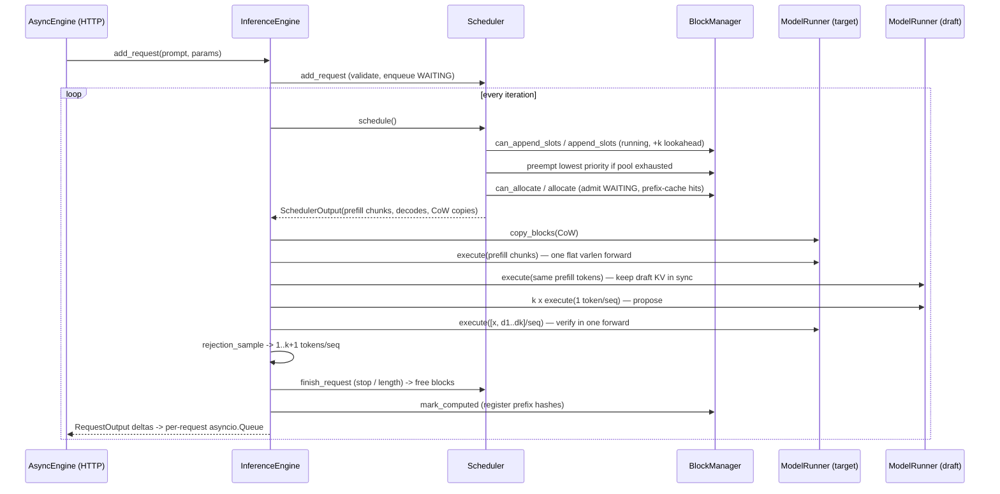
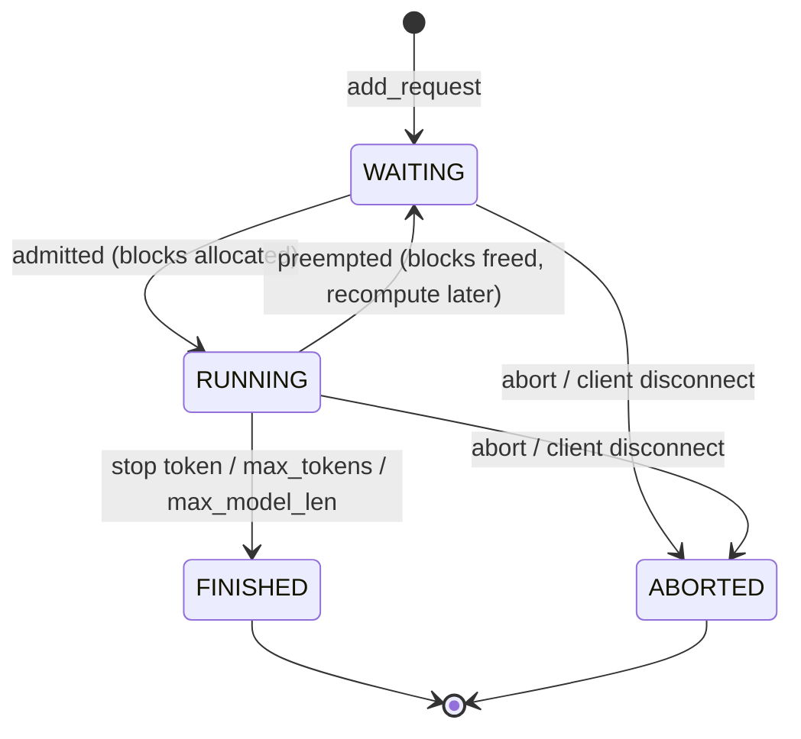

# Architecture

## Module map

```
src/tokenvault/
├── config.py               typed dataclass configs for every subsystem
├── engine.py               InferenceEngine: the step() loop that wires everything
├── model.py                Llama/Gemma decoder; paged forward + dense (HF-style) forward
├── model_loader.py         random presets, HF checkpoint import, tokenizers
├── scheduler.py            iteration-level scheduler, admission control, preemption
├── sampling.py             batched temperature / top-k / top-p; processed distributions
├── metrics.py              TTFT / TPOT / E2E percentiles, KV usage, $/1M tokens
├── cache/
│   ├── block_manager.py    physical block pool, block tables, ref-counts, CoW, prefix cache
│   ├── kv_cache.py         per-layer KV tensors, slot writes, block copies
│   └── paged_attention.py  AttentionMetadata + gather-based varlen PagedAttention
├── kernels/attention.py    backend dispatch + online-softmax (flash-decoding style) kernel
├── batching/
│   ├── request.py          Request state machine, RequestOutput
│   └── continuous.py       BatchItem -> flat varlen ModelInput; ModelRunner
├── speculative/
│   └── draft_verify.py     rejection sampler, SpeculativeDecoder, layer-skip draft
├── quant/
│   ├── int8.py             per-channel symmetric INT8 linear
│   ├── int4.py             group-wise asymmetric INT4 linear (packed nibbles)
│   └── calibrate.py        activation capture, AWQ scale search, PPL / KL evaluation
└── serving/api.py          OpenAI-compatible FastAPI app + AsyncEngine background loop
```

Dependency direction is strictly downward: `serving → engine → {scheduler, batching,
speculative, quant} → {cache, kernels, model}`. `cache/block_manager.py` imports nothing from
torch, which keeps its tests at microsecond speed.

## One engine step



## Request lifecycle



`num_computed_tokens` is the single source of truth for progress. A request is in **prefill**
while more than one token is uncomputed (or nothing has been generated); in **decode** exactly
one token — the last sampled — is uncomputed and is fed as the next query.

## Data shapes in a forward

| Tensor | Shape | Meaning |
|---|---|---|
| `input_ids`, `positions` | `[N]` | all scheduled tokens, concatenated |
| `slot_mapping` | `[N]` | flat KV slot each token's K/V is written to |
| `query_start_loc` | `[B+1]` | prefix sum of per-sequence query lengths |
| `context_lens` | `[B]` | KV length per sequence *after* this step's writes |
| `block_tables` | `[B, max_blocks]` | physical block ids, 0-padded (masked by `context_lens`) |
| `key_cache[l]` | `[num_blocks, block_size, kv_heads, head_dim]` | physical KV storage |

## Threading model (server)

One background asyncio task owns the loop and calls `engine.step()` in a worker thread so the
event loop stays responsive; handlers enqueue work under a lock and await a per-request
`asyncio.Queue`. Client disconnects abort the request and free its blocks immediately.
